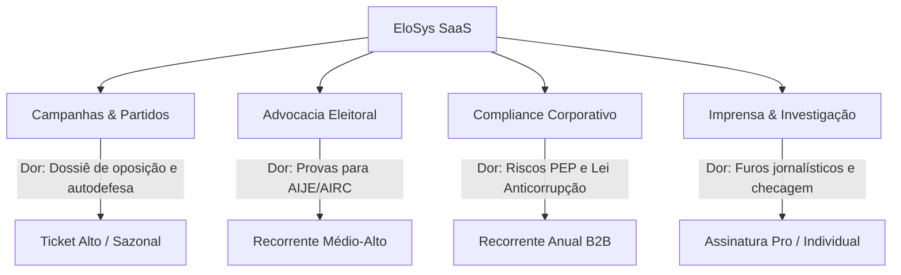
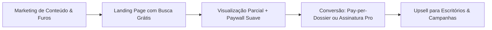

# EloSys SaaS — Visão de Negócios e Estratégia Comercial

## 1. Sumário Executivo

O **EloSys** resolve uma das maiores dores do mercado político, jurídico e investigativo brasileiro: **o acesso fragmentado e a incapacidade de cruzar em rede o volume massivo de dados do TSE e órgãos federais.**

Atualmente, o TSE, a Receita Federal e o Portal da Transparência disponibilizam terabytes de dados brutos que são:
- Extremamente lentos para consultar em massa no portal oficial (DivulgaCandContas);
- Isolados em silos (uma consulta não mostra se a gráfica contratada pertence ao sócio de um doador do adversário);
- Desprovidos de inteligência de rede (grafos de relacionamentos e detecção estatística de anomalias).

O **EloSys SaaS** se posiciona como a **plataforma líder de inteligência e auditoria de redes eleitorais**, transformando dados públicos brutos em relatórios periciais, grafos de conexões e sinais analíticos prontos em segundos.

---

## 2. Personas e ICP (Ideal Customer Profile)

Para construir um negócio lucrativo e sustentável, o foco comercial deve ser direcionado para públicos com **alto orçamento** e **alta dor**:

### ICP 1: Campanhas Políticas e Partidos (Inteligência & Oposição)
- **Quem são:** Coordenadores de campanha, marqueteiros, equipes de inteligência eleitoral de candidatos a Deputado, Senador, Prefeito e Governador.
- **A Dor:** 
  - Fazer levantamento da vida do adversário ("oposição research") para alimentar debates, programas eleitorais de TV/rádio e redes sociais.
  - Vetting de pré-candidatos da própria chapa para evitar escândalos antes do registro oficial.
- **Poder de Compra:** **Altíssimo** (recursos do Fundo Partidário e Fundo Especial de Financiamento de Campanha - FEFC).
- **Proposta de Valor:** "Em 5 minutos, tenha o mapa completo de todas as empresas, doadores e despesas suspeitas do seu adversário nos últimos 12 anos."

### ICP 2: Escritórios de Advocacia Eleitoral
- **Quem são:** Advogados especialistas em direito eleitoral atuando em tribunais regionais (TREs) e no TSE.
- **A Dor:** 
  - Produzir provas para Ações de Investigação Judicial Eleitoral (AIJE), Ações de Impugnação de Mandato Eletivo (AIME) e Ações de Impugnação de Registro de Candidatura (AIRC).
  - Defender clientes contra acusações de abuso de poder econômico, caixa dois ou doações ilegais.
- **Poder de Compra:** **Alto** (escritórios repassam o custo da ferramenta no valor dos honorários periciais).
- **Proposta de Valor:** "Gere dossiês com valor pericial, proveniência auditável de cada centavo e citações diretas dos arquivos públicos do TSE."

### ICP 3: Departamentos de Compliance & Due Diligence (B2B Corporativo)
- **Quem são:** Empresas de médio e grande porte, construtoras, empresas de terceirização, fundos de investimento que contratam com governos ou possuem políticas rígidas de ESG/Anticorrupção.
- **A Dor:** Checar fornecedores, parceiros e sócios contra listas de Pessoas Expostas Politicamente (PEP), doadores eleitorais e sanções do CEIS/CNEP.
- **Poder de Compra:** **Alto** (orçamento corporativo recorrente).
- **Proposta de Valor:** "Evite multas da Lei Anticorrupção (Lei 12.846/13) verificando se seus parceiros de negócios têm conexões ocultas com campanhas eleitorais."

### ICP 4: Jornalistas Investigativos e Agências de Fact-Checking
- **Quem são:** Repórteres do UOL, Folha, Estadão, O Globo, Agência Lupa, Aos Fatos, The Intercept, Repórter Brasil e veículos de mídia locais/regionais.
- **A Dor:** Precisam de furos jornalísticos com agilidade, sem perder dias manipulando arquivos CSV corrompidos do TSE.
- **Poder de Compra:** **Médio** (assinaturas individuais pagas pelos próprios jornalistas ou contas institucionais das redações).
- **Proposta de Valor:** "Descubra conexões que ninguém viu e exporte infográficos de rede prontos para publicar."

---

## 3. Matriz de Planos e Precificação (Pricing Strategy)

| Recurso / Benefício | Gratuito (Freemium) | Pro (Jornalista / Autônomo) | Escritório / Campanha (B2B) | Enterprise / API |
| :--- | :---: | :---: | :---: | :---: |
| **Preço Sugerido** | **R$ 0** | **R$ 149 / mês** | **R$ 890 a R$ 1.990 / mês** | **Sob Consulta** (mín. R$ 3.500/mês) |
| **Público** | Visitantes, curiosos, estudantes | Repórteres, pesquisadores | Escritórios jurídicos, diretórios partidários | Plataformas de KYC, grandes corporações |
| **Buscas por mês** | 10 buscas básicas | Ilimitadas | Ilimitadas (até 5 usuários) | Acesso via API REST |
| **Visualização em Grafo** | Bloqueado (apenas preview) | Completo (até 2 níveis) | Completo (níveis ilimitados + filtros) | Dados em JSON para grafos próprios |
| **Sinais de Anomalia** | Vê apenas quantidade | Vê detalhes dos sinais | Vê metodologia completa + cálculo pericial | Dados brutos de anomalias |
| **Exportação de Dossiê PDF**| Não disponível | 3 dossiês/mês | Dossiês Ilimitados com logo customizável | Geração em lote via API |
| **Suporte** | Comunidade | E-mail (48h) | WhatsApp prioritário | SLA de 4 horas |

### Pacotes Sazonais para Campanhas (Ticket Alto)
Campanhas eleitorais operam em ciclos curtos de 3 a 6 meses. Para elas, não se vende assinatura mensal longa, vende-se o **"Passe de Campanha"**:
- **Pacote Campanha Municipal (Vereador/Prefeito cidade média):** R$ 4.900 (acesso por 4 meses + 1 dossiê aprofundado de adversário).
- **Pacote Campanha Majoritária (Prefeito capital / Deputado / Senador):** R$ 18.000 a R$ 35.000 (acesso ilimitado para equipe, monitoramento diário de movimentações eleitorais, suporte investigativo).

### Venda Avulsa: Pay-per-Dossier (Entrada Rápida)
- Usuários do plano gratuito podem adquirir um **"Dossiê Completo de Candidato em PDF"** por **R$ 79,00 via PIX instantâneo**, sem necessidade de assinar plano mensal.

---

## 4. Estratégia de Go-to-Market (GTM)

1. **A Estratégia dos "Furos de Dados" (Viralização Orgânica):**
   - Utilizar a própria ferramenta para identificar 1 anomalia curiosa ou caso relevante por semana e publicar no X/Twitter, LinkedIn e newsletter especializada.
   - Incluir sempre a imagem do grafo gerado pelo EloSys e o link direto para a consulta ("Veja o grafo interativo no EloSys").
2. **Parcerias Estratégicas:**
   - Oferecer contas cortesia para professores de jornalismo de dados (ex: Abraji) e agências de checagem. Isso gera credibilidade imediata da marca.
3. **Outbound Direcionado (Vendas Ativas B2B):**
   - Mapear escritórios de advocacia eleitoral no Brasil (cerca de 1.500 escritórios especializados).
   - Abordagem consultiva: enviar uma demonstração em vídeo de 2 minutos mostrando como o EloSys encontrou doações circulares em uma cidade onde o escritório atua.
