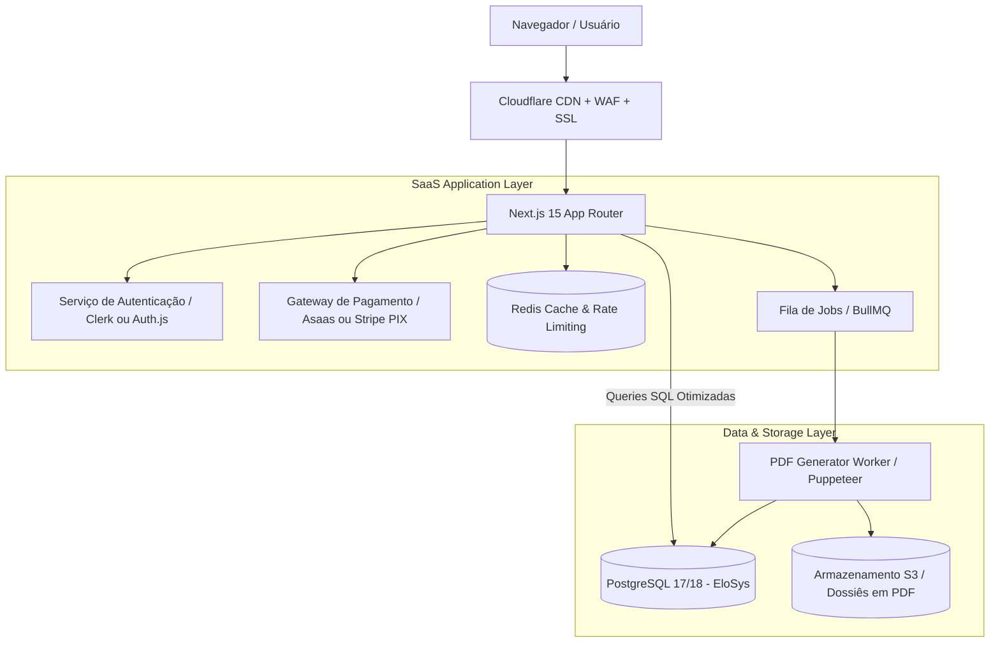
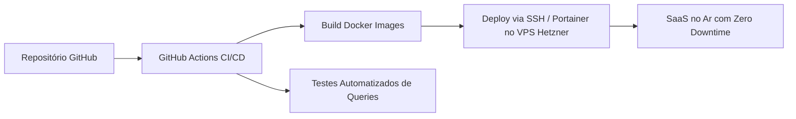

# EloSys SaaS — Arquitetura Técnica, Infraestrutura e Custos

## 1. Visão Geral da Arquitetura

O EloSys foi concebido com uma separação clara entre a **Camada de Coleta (Python ETL)**, o **Armazenamento Analítico (PostgreSQL)** e a **Aplicação Web (Next.js)**. 

Para a versão SaaS comercial, a arquitetura é expandida com serviços de **Autenticação**, **Controle de Assinaturas (Billing)**, **Cache Distribuído**, e **Fila de Tarefas Assíncronas (Workers)**:

---

## 2. Estratégia de Banco de Dados e Multi-Tenancy

O EloSys possui um banco analítico de **~12 GB e mais de 35 milhões de registros**. Não faz sentido duplicar essa base para cada cliente.

### Modelo Híbrido Recomendado:
1. **Schema Analítico Público (`public`):**
   - Dados eleitorais do TSE, Receita Federal, Portal da Transparência, sanções e sinais matemáticos.
   - Acesso em modo **estritamente leitura (`readonly`)** para todos os usuários.
2. **Schema Operacional do SaaS (`saas`):**
   - Tabelas de controle de usuários, organizações, planos, histórico de buscas, dossiês gerados e limites de uso:
     - `saas.users` (id, email, name, role, created_at)
     - `saas.subscriptions` (user_id, plan_id, status, current_period_end, gateway_id)
     - `saas.query_usage` (user_id, month, query_count, graph_views)
     - `saas.saved_dossiers` (id, user_id, candidate_id, pdf_url, generated_at)
     - `saas.watchlists` (id, user_id, monitored_person_id, notify_email)
     - `saas.audit_logs` (id, user_id, action, ip_address, timestamp)

---

## 3. Autenticação, Planos e Controle de Acesso (RBAC)

- **Autenticação:** [Clerk](https://clerk.com) ou [Auth.js (NextAuth)](https://authjs.dev)
  - Login social (Google, LinkedIn) + E-mail/Senha com 2FA (obrigatório para contas governamentais/jurídicas).
  - Suporte a Organizações (múltiplos usuários no mesmo plano empresarial).
- **Controle de Limites (Rate Limiting & Quotas):**
  - Implementado via Middleware do Next.js + Redis:
    - Usuário Gratuito: máx. 5 consultas por hora, visualização de grafos bloqueada.
    - Usuário Pro: consultas ilimitadas, 3 exportações de dossiê/mês.
    - Usuário B2B: sem restrições.

---

## 4. Gateway de Pagamento e Faturamento

Para o mercado brasileiro, **PIX e Boleto são essenciais**, especialmente para partidos políticos e órgãos públicos (que não utilizam cartão de crédito internacional).

- **Gateway Principal Recomendado:** **Asaas** ou **Pagar.me** (ou **Stripe Brasil**).
  - Suporte a PIX com confirmação em tempo real via Webhook.
  - Emissão automática de Nota Fiscal de Serviço (NFS-e) integrada.
  - Cobrança recorrente com gestão de inadimplência (dunning).

---

## 5. Infraestrutura, Hospedagem e Custos Reais

Diferente de sistemas que exigem clusters caros na nuvem, o EloSys é extremamente eficiente porque usa PostgreSQL indexado e Next.js com Server Components.

### Estimativa de Custo Mensal (Fase MVP até 5.000 usuários):

| Recurso | Provedor Recomendado | Especificações | Custo Estimado / Mês |
| :--- | :--- | :--- | :--- |
| **Servidor Dedicado / VPS** | **Hetzner Cloud** (ou Contabo / DigitalOcean) | 8 vCPU, 16 GB RAM, 240 GB NVMe SSD | € 22,00 (~ R$ 135,00) |
| **Edge CDN & Segurança** | **Cloudflare** | Plano Free / Pro (DDoS protection, WAF, SSL) | R$ 0,00 |
| **Cache & Filas** | Redis (local no VPS via Docker) | 2 GB alocados | R$ 0,00 |
| **Armazenamento de PDFs** | Cloudflare R2 | 10 GB de armazenamento (sem custo de tráfego) | R$ 0,00 |
| **Autenticação** | Clerk | Até 10.000 usuários ativos mensais (MAU) | R$ 0,00 (Plano Free) |
| **E-mails Transacionais** | Resend / Amazon SES | Envio de login, confirmação de PIX e alertas | R$ 0,00 a R$ 20,00 |
| **Gateway de Pagamento** | Asaas | Taxa por transação confirmada (R$ 0,99 por PIX) | Variável (% da receita) |
| **TOTAL FIXO MENSAL** | — | — | **~ R$ 150,00 a R$ 180,00 / mês** |

> [!TIP]
> **Margem Operacional:** Com um custo de infraestrutura inferior a R$ 200,00/mês, **apenas 2 assinantes do Plano Pro (R$ 149/mês)** já cobrem 100% dos custos fixos de servidor do projeto inteiro.

---

## 6. Pipeline de Deploy Automatizado

- **Containerização:** Docker Compose gerenciando `web` (Next.js), `db` (PostgreSQL), `redis` (Cache) e `worker` (Geração de Dossiês).
- **Reverse Proxy:** Nginx ou Caddy com renovação automática de certificados SSL e compressão Brotli.
- **Backup Automatizado:** Script diário via cron fazendo dump do schema `saas` e enviando para bucket S3 com retenção de 30 dias.
