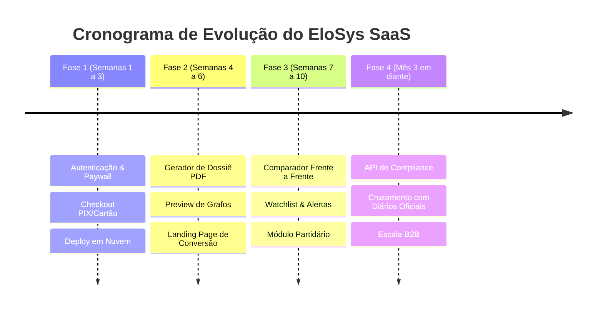
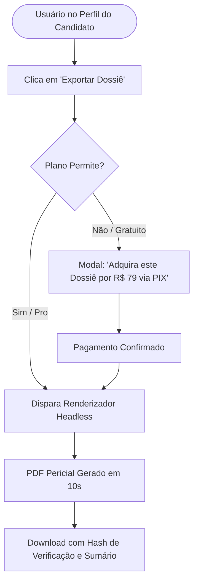

# EloSys SaaS — Roadmap de Produto e Funcionalidades

## 1. Visão Geral das Fases de Desenvolvimento

O objetivo deste roadmap é levar o EloSys do seu estágio atual (**aplicação funcional em localhost**) até um **SaaS de receita recorrente validado no mercado**.



---

## 2. Detalhamento das Fases

### Fase 1: MVP Comercializável (Monetização Imediata)
**Objetivo:** Permitir que o sistema seja colocado no ar em um domínio próprio e comece a capturar usuários e pagamentos.

* [ ] **Deploy em Nuvem (VPS Hetzner + PostgreSQL 18):**
  * Configurar servidor Linux, Docker Compose, PostgreSQL com volume persistente e Nginx/Cloudflare.
* [ ] **Camada de Autenticação (Clerk ou Auth.js):**
  * Cadastro e login via Google e E-mail.
  * Criação do perfil do usuário no banco (`saas.users`).
* [ ] **Integração de Pagamento com PIX e Cartão (Asaas ou Stripe):**
  * Checkout transparente ou página de assinatura.
  * Webhook para ativação instantânea do plano após pagamento.
* [ ] **Controle de Acesso e Paywall:**
  * Usuários não logados: busca liberada, mas ao clicar para ver a "Ficha Completa" ou "Grafo", solicita login.
  * Usuários gratuitos: limite de 5 visualizações completas/mês.
  * Usuários pagantes: acesso irrestrito.

---

### Fase 2: A "Killer Feature" (Dossiê Pericial em PDF)
**Objetivo:** Criar o recurso com o maior valor percebido e a maior taxa de conversão em vendas do sistema.



* [ ] **Gerador de Dossiês Automatizados:**
  * Relatório com formatação jurídica e jornalística profissional contendo:
    1. Sumário Executivo do Político (histórico de cargos e eleições disputadas);
    2. Evolução Patrimonial Gráfica (2014 a 2026);
    3. Top 10 Doadores e Top 10 Fornecedores de Campanha;
    4. Quadro de Anomalias (Doações circulares, empresas com sanção no CEIS/CNEP, despesas desproporcionais);
    5. Imagem em alta resolução da Rede de Relacionamentos (Grafo);
    6. Rodapé com Carimbo de Proveniência (data/hora, link oficial do TSE e hash de conferência).
* [ ] **Landing Page de Alta Conversão:**
  * Página inicial com exemplos reais (ex: "Veja o caso da campanha X"), depoimentos e chamada para teste gratuito.

---

### Fase 3: Retenção e Expansão B2B
**Objetivo:** Aumentar o LTV (Lifetime Value) e reter clientes corporativos, escritórios de advocacia e diretorias partidárias.

* [ ] **Módulo "Comparador de Candidatos" (Frente a Frente):**
  * Selecionar dois políticos e gerar um comparativo automático:
    - Quem arrecadou mais?
    - Existem fornecedores em comum entre os dois?
    - Existem doadores que contribuíram para ambos na mesma eleição?
* [ ] **Sistema de Monitoramento e Alertas (Watchlist):**
  * O assinante "segue" um político ou CNPJ.
  * Notificação por e-mail ou WhatsApp sempre que houver atualização cadastral, nova prestação de contas parcial ou sanção pública.
* [ ] **Multi-usuários (Contas Corporativas):**
  * Painel para escritórios de advocacia gerenciarem acessos de seus advogados e estagiários.

---

### Fase 4: Inteligência Avançada e API Enterprise
**Objetivo:** Vender para grandes clientes de compliance e plataformas financeiras.

* [ ] **API REST de Auditoria:**
  * Endpoints autenticados por API Key (`/api/v1/politician/{cpf}`, `/api/v1/company/{cnpj}/risk-score`).
* [ ] **Cruzamento com Diários Oficiais (Licitações x Doadores):**
  * Identificar se uma empresa que doou para a campanha do Prefeito ganhou contratos públicos com a prefeitura no ano seguinte.
* [ ] **Score de Risco Eleitoral:**
  * Algoritmo proprietário que atribui uma pontuação de 0 a 100 de conformidade cadastral e financeira.

---

## 3. Matriz de Priorização (Esforço vs Impacto)

```
        ▲ ALTO
        │     [Paywall & Checkout PIX]        [Dossiê Pericial em PDF]
        │     (Fase 1 - Alto Impacto)          (Fase 2 - Altíssimo Impacto)
IMPACTO │
        │     [Deploy VPS Hetzner]             [Comparador de Candidatos]
        │     (Fase 1 - Essencial)             (Fase 3 - Diferencial B2B)
        │
        │     [API REST Enterprise]            [Cruzamento com Diários]
        │     (Fase 4 - Longo Prazo)           (Fase 4 - Alto Esforço)
        └─────────────────────────────────────────────────────────────►
          BAIXO                     ESFORÇO                     ALTO
```
