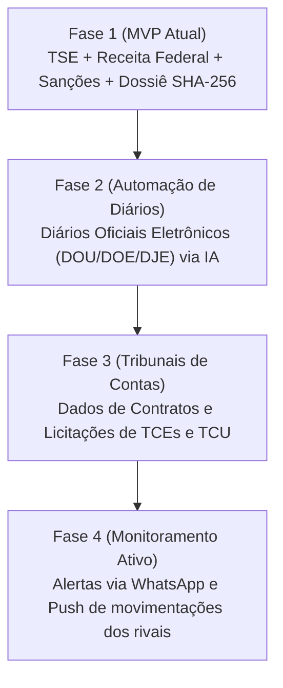

# Estratégia Comercial, Precificação, Unit Economics & Escala · Eletto

---

## 1. Visão Geral do Modelo de Negócios

O **Eletto** opera sob um modelo híbrido de **SaaS B2B Recorrente** combinado com **Monetização Transacional (Pay-Per-Use)** e **Pacotes de Alto Ticket Sazonais**. 

Essa combinação resolve o maior desafio de produtos políticos no Brasil: capturar receita volumosa durante os picos eleitorais e garantir previsibilidade financeira e retenção durante o período entresafra.

---

## 2. Estrutura de Precificação e Planos

| Plano | Preço | Público Ideal | Funcionalidades Incluídas |
|---|---|---|---|
| **Dossiê Avulso (Pay-per-use)** | **R$ 79,00** (pagamento único) | Advogados com caso pontual, jornalistas e peritos | 1 Dossiê Pericial completo em PDF com hash SHA-256 e fé pública |
| **Plano Pro Mensal** | **R$ 149,00** / mês | Advogados autônomos, consultores políticos e analistas | Dossiês ilimitados, Minuta Jurídica IA, Exportação CSV/Excel, Grafo e Comparador |
| **Plano Pro Anual** | **R$ 1.188,00** / ano *(R$ 99/mês)* | Escritórios de advocacia que acompanham mandatos e TREs | Tudo do Pro Mensal com 33% de desconto e suporte prioritário |
| **Plano Escritório (B2B)** | **R$ 490,00** / mês | Bancas de advocacia eleitoral e consultorias | Até 5 usuários simultâneos, Timbre White-label oficial da banca nos laudos |
| **Combo de Campanha (Sazonal)** | **R$ 4.900 a R$ 14.900** / pleito | Comitês de campanha majoritária (Prefeito / Deputado / Senador) | Monitoramento 24/7 de adversários, auditoria de doações recebidas pelos rivais e relatórios sob demanda |

---

## 3. Unit Economics & Viabilidade Financeira

### 3.1 Custo Operacional por Usuário (COGS)
- **Hospedagem Web + PostgreSQL:** ~R$ 120 a R$ 250 / mês (capacidade para dezenas de milhares de requisições).
- **Custo de IA (Google Gemini 1.5/2.0 API):** ~R$ 0,02 a R$ 0,05 por minuta jurídica ou sumário gerado.
- **Taxa do Gateway de Pagamento (Stripe):** 3,99% + R$ 0,39 por transação aprovada.
- **Margem Bruta (Gross Margin):** **86% a 92%**. O produto tem alavancagem operacional extrema típica de software de inteligência.

### 3.2 Indicadores Projetados
- **CAC Médio Estimado (Custo de Aquisição):**
  - Via MDV / Indicação Orgânica: **R$ 0 a R$ 45**.
  - Via Tráfego Pago Focado (Google Search com palavras-chave de alta intenção como *"prestação de contas eleitoral impugnação"*): **R$ 120 a R$ 220**.
- **LTV Médio Projetado (Lifetime Value):**
  - Cliente Pro Mensal em Ano Eleitoral (5 meses de permanência média): **R$ 745**.
  - Cliente Pro Anual: **R$ 1.188**.
  - Banca de Advocacia (LTV de 2 anos): **~R$ 5.880**.
- **Razão LTV / CAC:** Superior a **4.5x** (indicador considerado excelente no benchmark de SaaS B2B).

---

## 4. Gestão da Sazonalidade (Estratégia Entresafra)

No Brasil, os anos ímpares não possuem eleições oficiais, o que tradicionalmente causa queda na demanda de ferramentas eleitorais genéricas. O Eletto foi arquitetado para contornar esse risco através de 3 pilares:

### Pilar 1: O Contencioso Pós-Eleitoral Dura 2 a 3 Anos
Julgamentos de AIME (Ação de Impugnação de Mandato Eletivo), cassações por abuso de poder econômico e defesas de desaprovação de contas no TSE/TRE tramitam por anos após a votação. Advogados precisam dos dados do Eletto durante todo o mandato do político.

### Pilar 2: Expansão para Compliance e Background Check Empresarial
Médias e grandes empresas utilizam a mesma ferramenta para checar sócios e fornecedores que possam figurar em listas de sanções (CEIS/CNEP) ou manter vínculos de parentesco com agentes políticos em exercício (prevenção contra crimes de corrupção e Lei das Estatais).

### Pilar 3: Trava de Assinatura Anual com Desconto Agressivo
Oferecer o plano anual antes do fechamento das convenções partidárias garante que a receita da banca já esteja capturada pelos 12 meses seguintes.

---

## 5. Roadmap de Escala Técnica e Expansão de Dados

1. **Fase 1 (Produção Atual):** Cruzamento consolidado TSE (2014–2024), Receita Federal (QSA/CNPJ), Portal da Transparência (Emendas e Sanções CEIS/CNEP).
2. **Fase 2 (Diários Oficiais via IA):** Leitura automática de citações e portarias nos diários oficiais dos estados e municípios onde o político atua.
3. **Fase 3 (Tribunais de Contas):** Cruzamento das empresas doadoras/fornecedoras de campanha com contratos vigentes em prefeituras e governos estaduais (TCEs e TCU).
4. **Fase 4 (Alertas Proativos por WhatsApp):** Envio de mensagem instantânea para o assessor ou advogado quando um adversário político sofrer qualquer nova movimentação de bens, doação ou processo.
