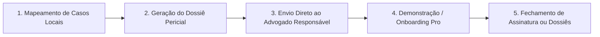

# Mínima Distribuição Viável (MDV) · Go-To-Market Lean

---

## 1. O Conceito de Mínima Distribuição Viável (MDV)

Ter um MVP tecnicamente impecável não garante tração. O **MDV (Mínima Distribuição Viável)** é a estratégia mais enxuta, barata e ágil para colocar o **Eletto** na rotina de trabalho dos **primeiros 50 a 100 usuários pagantes**, sem depender de altos investimentos em anúncios pagos (Google/Meta Ads) no início.

O objetivo do MDV é:
1. Validar a disposição a pagar (*Willingness to Pay*) de bancas e campanhas.
2. Descobrir os gatilhos exatos de conversão do Dossiê Pericial e das Minutas com IA.
3. Criar os primeiros casos de sucesso com autoridade indiscutível.

---

## 2. A Estratégia Central: O "Dossiê Isca" (Trojan Dossier)

A melhor forma de vender para advogados eleitorais e estrategistas políticos não é fazer propaganda genérica de software, mas **mostrar a inteligência pronta na mesa deles**.

### O Passo a Passo da Estratégia:

1. **Mapeamento:** Selecionar eleições municipais ou disputas estaduais acirradas onde já existem ações de impugnação de mandato (AIME) ou investigação eleitoral (AIJE).
2. **Geração:** Utilizar o Eletto para gerar o Dossiê Pericial com SHA-256 do adversário político em questão, destacando 2 ou 3 anomalias (ex.: fornecedor de campanha que é sócio do candidato ou doações circulares).
3. **Abordagem Direta:** Entrar em contato direto com o advogado ou coordenador jurídico da campanha adversária com uma mensagem personalizada e sem "pitch de vendas" agressivo.
4. **Oferta:** *"Identificamos estas inconsistências auditadas na prestação do candidato X. Estamos liberando a íntegra do dossiê com carimbo pericial e sua chave de acesso PRO cortesia por 7 dias."*
5. **Conversão:** O advogado utiliza o dossiê para peticionar e percebe que economizou 2 semanas de trabalho braçal. Ao término dos 7 dias, a assinatura PRO ou compra de créditos avulsos é fechada naturalmente.

---

## 3. Canais Orgânicos de Aquisição com Custo Zero

### Canal 1: Parcerias Institucionais com Comissões da OAB
- **Ação:** Propor palestras, webinars ou artigos técnicos em comissões estaduais de **Direito Eleitoral** e **Direito Digital da OAB**.
- **Tema:** *"Uso de Criptografia e Auditoria de Dados Públicos na Instrução Probatória de AIJEs e Prestações de Contas"*.
- **Resultado:** Acesso direto a centenas de advogados eleitoralistas com alta autoridade e validação de marca.

### Canal 2: Pautas para Jornalistas Investigativos de Política
- **Ação:** Entregar investigações prontas para repórteres de grandes veículos (Folha, Estadão, Metrópoles, O Globo, Congresso em Foco, The Intercept).
- **Mecânica:** Exportar dados do Eletto comprovando uma triangulação de verba pública com empresa de fachada e oferecer com exclusividade.
- **Contrapartida:** Citação obrigatória: *"Conforme levantamento pericial auditado pela plataforma Eletto"*.
- **Impacto:** Backlinks de alta autoridade para o domínio, credibilidade instantânea e picos de acessos qualificados.

### Canal 3: Comunidades Especializadas de WhatsApp e Telegram
- **Público:** Grupos de assessores parlamentares, consultores eleitorais da ABRAPEL (Associação Brasileira de Consultores Políticos) e contadores de campanha.
- **Atuação:** Compartilhar insights semanais baseados no Comparador de Candidatos do Eletto (ex.: *"Os 10 deputados que mais concentraram verba em um único fornecedor em 2024"*).

---

## 4. Scripts Práticos de Abordagem B2B

### Script A: E-mail / WhatsApp para Sócio de Escritório Eleitoralista
> **Assunto:** Levantamento de dados periciais sobre a prestação de contas de [Nome do Adversário]
>
> *Olá, Dr. [Nome do Advogado]. Acompanho a atuação do seu escritório na área eleitoral em [Estado/Região].*
>
> *Nossa equipe gerou uma auditoria pericial automatizada sobre a prestação de contas do candidato [Nome do Adversário] no TSE e identificamos [ex.: concentração atípica de 68% dos gastos em empresa com sócio em comum / indício de doação fracionada].*
>
> *Gerei o Dossiê Pericial completo com protocolo e hash de autenticidade SHA-256 e gostaria de disponibilizá-lo como cortesia para auxiliar sua equipe jurídica. Segue o link com acesso aberto: [Link do Dossiê].*
>
> *Caso queira testar a plataforma para auditar outros alvos ou redigir minutas automáticas, ativei um acesso Pro de cortesia para seu e-mail corporativo.*
>
> *Um abraço,*
> *[Seu Nome / Equipe Eletto]*

---

## 5. Metas de Validação para os Primeiros 60 Dias

| Meta | Indicador Quantitativo | Critério de Sucesso |
|---|---|---|
| **Abordagens de Dossiê Isca** | 60 bancas contatadas | Taxa de abertura de dossiês > 40% |
| **Conversão em Clientes Pagantes** | 15 a 25 bancas ativas | Fechamento de plano Mensal Pro ou Escritório |
| **Vendas Avulsas de Dossiê** | 40 a 60 dossiês comprados (R$ 79 cada) | Pagamento via Stripe homologado |
| **Exposição na Imprensa** | Pelo menos 2 matérias com citação | Prova social para a Landing Page |

---

## 6. Próximo Passo do MDV
Assim que o deploy for concluído, executar a lista dos primeiros **20 alvos municipais estratégicos** para rodar a primeira leva da estratégia do Dossiê Isca.
